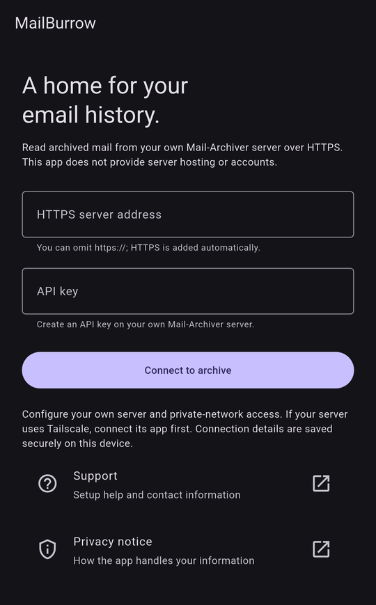

# MailBurrow

A read-only Android and iOS app for browsing your own [Mail-Archiver](https://github.com/s1t5/mail-archiver) server. Browse and search archived mail, filter by folder and date, read messages in a simplified view, and save attachments when you choose to.

MailBurrow is an early source preview. There is no public signed download yet and it is not in the app stores; you can build it yourself from source. See [project status](docs/testing/status.md).



> **New here? Start with the [setup guide](docs/setup-guide.md).** It shows how MailBurrow, Mail-Archiver and your HTTPS address fit together, with step-by-step settings for Mail-Archiver's API, TrueNAS and Tailscale, and fixes for common connection errors.

## What you need before connecting

MailBurrow is a client for an archive you run yourself. It is not a hosted email service and does not connect to Gmail or any mailbox with your email password.

1. A [Mail-Archiver server](https://github.com/s1t5/mail-archiver) with your archived mail and API access turned on. TrueNAS is one way to host it, but not a requirement.
2. An **HTTPS address with a valid certificate** for that server, and an API key created on it.
3. If your server is only reachable through **Tailscale**, your own Tailscale account with the Tailscale app connected on your phone. Any other working HTTPS setup is fine too.

The [setup guide](docs/setup-guide.md) explains how the pieces fit together and the exact settings for Mail-Archiver, TrueNAS and Tailscale. The project does not host servers, provide accounts or set up private networks. Server permissions, retention, logs and backups are up to you or your server administrator.

## Install

There is no public signed APK or App Store build yet. To try MailBurrow now:

- **Before installing,** set up your server with the [setup guide](docs/setup-guide.md); the app needs it to connect.
- **Android:** build it from source (see [Building from source](#building-from-source)). `flutter build apk --debug --target-platform android-arm64` produces a debug APK that installs as **MailBurrow Preview**, separately from any signed release.
- **iPhone and iPad:** build and run from source on a Mac with Xcode.

When signed releases are published, they will appear on the [Releases page](https://github.com/Kuncarlos91/MailBurrow/releases) and install over each other without losing your saved connection.

## Connect

1. Connect Tailscale first, if your server needs it.
2. Enter your server address. `https://` is added if you leave it out.
3. Enter your API key and tap **Connect to archive**.
4. If your key can see more than one mail account, switch between them from the account row or Settings.

Your server address and key are saved in the device's secure storage. Never send them to app support. If the connection fails, see the [setup guide's checks](docs/setup-guide.md#if-something-goes-wrong) and [troubleshooting](docs/troubleshooting/README.md).

## Security and privacy

- **Read-only:** the app never changes, deletes or sends mail.
- **HTTPS only,** with certificate checks and redirects refused, so your key goes only to the server you entered.
- **Bounded downloads:** response sizes, attachment sizes and request times are capped.
- **Careful with content:** remote images don't load automatically, links ask before opening, and risky attachment types get a warning.
- **No analytics or crash reporting.** Your server may still keep its own access logs.

Details are in the [privacy notice](PRIVACY.md). To report a security problem privately, see [SECURITY.md](SECURITY.md). For app help, use the [support and privacy contact](docs/security/public-contacts.md#support-and-privacy).

## Documentation

This README is the main documentation index. The [Playbook](docs/PLAYBOOK.md) covers features, design, architecture and API use.

**Using and testing:** [Setup guide](docs/setup-guide.md) · [Troubleshooting](docs/troubleshooting/README.md) · [Project status](docs/testing/status.md) · [Device testing checklist](docs/testing/device-checklist.md) · [Changelog](CHANGELOG.md)

**Development:** [Contributing](CONTRIBUTING.md) · [Setup and CI](docs/development/setup-and-ci.md) · [Documentation rules](docs/development/documentation.md) · [Dart/Flutter dependencies](docs/development/dependencies.md) · [Android native dependencies](docs/development/native-dependencies.md) · [Android native license review](docs/development/android-native-license-review.md) · [Third-party notices](docs/development/third-party-notices.md) · [iOS native evidence](docs/development/ios-native-evidence.md) · [App icons](docs/development/app-icons.md) · [Android signing](docs/releasing/android.md) · [Repository working instructions](AGENTS.md)

**Security and licenses:** [Code of conduct](CODE_OF_CONDUCT.md) · [Privacy notice](PRIVACY.md) · [Security reporting](SECURITY.md) · [Public contacts](docs/security/public-contacts.md) · [Artifact privacy rules](docs/security/artifact-privacy-rules.md) · [Artifact privacy investigation](docs/troubleshooting/artifact-privacy.md) · [Third-party licenses](THIRD_PARTY_NOTICES.md)

## Building from source

Open the repository root as a Flutter project. Use Flutter 3.47.8 stable; Dart is bundled. Android needs the Android SDK. iOS needs macOS and Xcode.

```powershell
flutter pub get --enforce-lockfile
flutter analyze --no-pub --fatal-infos
flutter test --no-pub
python tools/check_docs.py
flutter run
```

App code is in `lib/`, tests in `test/`, native projects in `android/` and `ios/`, and helper scripts in `tools/`. Run Android Gradle commands from `android/` and everything else from the repository root.

Debug builds use a debug key. Signed release builds require your own local signing configuration: the ignored `keystore.properties` (see `keystore.properties.example` and [Android signing](docs/releasing/android.md)). Signing materials never go in Git. Contributions are welcome; see [CONTRIBUTING.md](CONTRIBUTING.md).

## How this app is built

MailBurrow is developed by one person with the help of AI coding assistants. Every change runs through automated analysis and tests, plus documentation and privacy checks, and new builds are tried on real devices before they are shared. The code is open to review under the license below. Report problems in [GitHub issues](https://github.com/Kuncarlos91/MailBurrow/issues), and security issues as described in [SECURITY.md](SECURITY.md).

## License

MailBurrow's own code is licensed under the [MIT License](LICENSE). Third-party packages keep their own licenses; see [third-party notices](THIRD_PARTY_NOTICES.md).
