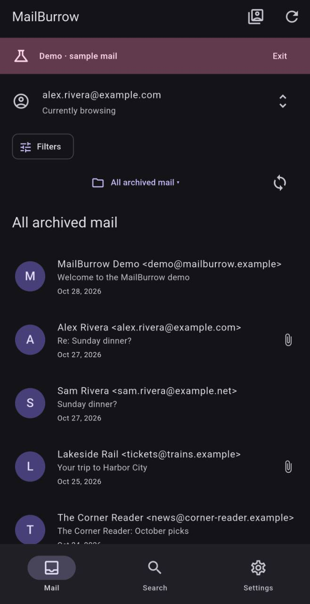
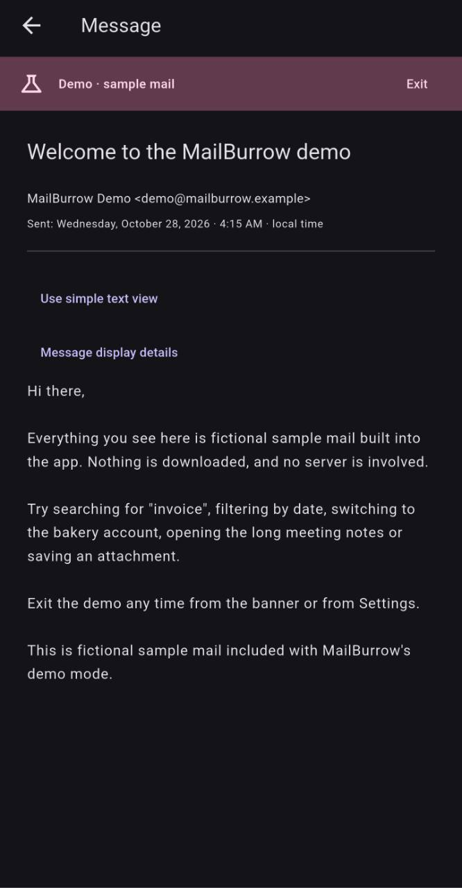
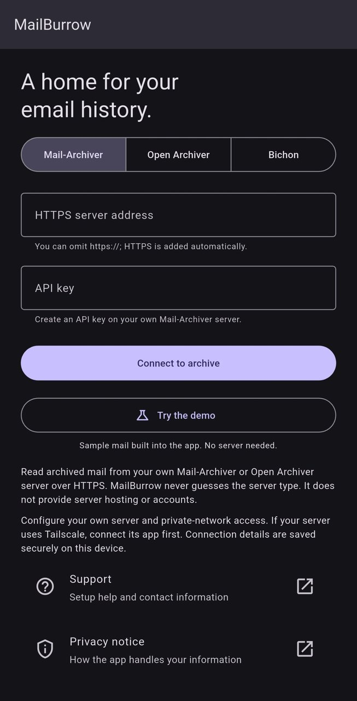

<h1 align="center">MailBurrow</h1>

<p align="center">Read your self-hosted mail archives on your phone.</p>

<p align="center">
  <a href="https://github.com/Kuncarlos91/MailBurrow/releases/latest"></a>
  <a href="https://github.com/Kuncarlos91/MailBurrow/actions/workflows/flutter-checks.yml?query=branch%3Amain"></a>
  <a href="#install"></a>
  <a href="LICENSE"></a>
</p>

<p align="center">
  <a href="https://github.com/Kuncarlos91/MailBurrow/releases/latest"><strong>Download Android</strong></a> ·
  <a href="#try-it-without-a-server">Try the demo</a> ·
  <a href="docs/setup-guide.md">Setup guide</a> ·
  <a href="https://github.com/Kuncarlos91/MailBurrow/issues/new/choose">Feedback / report a problem</a>
</p>

A read-only Android and iOS app for browsing your own [Mail-Archiver](https://github.com/s1t5/mail-archiver), [Open Archiver](https://github.com/LogicLabs-OU/OpenArchiver) or [Bichon](https://github.com/rustmailer/bichon) server. Browse and search archived mail, filter by date and supported folder options, read messages in a simplified view, and save attachments when you choose to.

MailBurrow is an early preview. A signed Android release, [0.5.0](https://github.com/Kuncarlos91/MailBurrow/releases/tag/v0.5.0), is available for 64-bit ARM phones. iOS 0.5.0 has passed maintainer-reported internal TestFlight checks on an iPad but is not published, so iPhone/iPad users build from source. See [project status](docs/testing/status.md).

**New here?** Install the Android APK and tap **Try the demo** for fictional mail with no server or network needed. The demo is inside the app. To connect your own archive, follow the [setup guide](docs/setup-guide.md).

## Why MailBurrow?

- Browse and search without sending, changing or deleting mail.
- Save up to 20 archive connections and switch between them.
- Fetch mail on demand, with no offline mail cache, analytics or crash-report upload.
- Read with remote content blocked; save attachments only when you choose.

## Tested servers

<p>
  <a href="docs/testing/status.md#tested-servers"></a>
  <a href="docs/testing/status.md#tested-servers"></a>
  <a href="docs/testing/status.md#tested-servers"></a>
</p>

Android 0.5.0 was tested with Mail-Archiver 2611.2, Open Archiver 0.6.2 and Bichon 2.4.2 Community; other server versions and Bichon Pro/Enterprise are unverified. See [tested servers and known limits](docs/testing/status.md#tested-servers).

## What you need before connecting

MailBurrow is a client for an archive you run yourself. It is not a hosted email service and does not connect to Gmail or any mailbox with your email password.

1. A [Mail-Archiver](https://github.com/s1t5/mail-archiver) server with API access turned on, an [Open Archiver](https://github.com/LogicLabs-OU/OpenArchiver) 0.6.2 server, or a [Bichon](https://github.com/rustmailer/bichon) 2.4.2 Community server, with your archived mail. TrueNAS is one way to host them, but not a requirement.
2. An **HTTPS address with a valid certificate** for that server, and an API key created on it (for Bichon, an access token for a read-only user).
3. If your server is only reachable through **Tailscale**, your own Tailscale account with the Tailscale app connected on your phone. Any other working HTTPS setup is fine too.

The [setup guide](docs/setup-guide.md) explains how the pieces fit together and the exact settings for Mail-Archiver, Open Archiver, Bichon, TrueNAS and Tailscale. The project does not host servers, provide accounts or set up private networks. Server permissions, retention, logs and backups are up to you or your server administrator.

## Try it without a server

The setup screen has a **Try the demo** button. It opens a small archive of made-up mail built into the app: three fictional accounts (a person, a bakery and a garden club) with folders, attachments and several years of messages. Everything works as it would with a real server, including search, filters, paging, the reader, saving attachments and switching accounts.

- A **Demo · sample mail** bar stays on every screen. Tap its **Exit** button, or **Settings → Exit demo**, to leave. Closing the app also leaves the demo.
- The demo connects to no server, sends nothing over the network and never saves or changes a connection, so a real connection you saved earlier is kept.
- **Development builds:** leaving a demo started from an open real archive reconnects to that archive, using saved credentials and the normal Opening/Cancel flow. That reconnection contacts its server and may update its saved selection; it adds no archive. Published 0.5.0 returns to setup instead.
- Saving a demo attachment still uses the normal save dialog, and confirmed links still open in your browser, just as with a real archive.

Android in dark mode, using fictional demo mail: **browse mail** (first), then **read a message** (second).

 

## Install

MailBurrow is not in the app stores. To try it:

- **Before installing,** set up your server with the [setup guide](docs/setup-guide.md); the app needs it to connect.
- **Android:** download `MailBurrow-0.5.0-build31.apk` from the [0.5.0 release](https://github.com/Kuncarlos91/MailBurrow/releases/tag/v0.5.0) and compare its SHA-256 with the one in the release notes. It is for 64-bit ARM (arm64-v8a) devices; 32-bit-only phones cannot install it. Not ready to connect a server? Tap **Try the demo** on setup. You can also build it from source (see [Building from source](#building-from-source)): `flutter build apk --debug --target-platform android-arm64` produces a debug APK that installs as **MailBurrow Preview**, separately from the signed release.
- **iPhone and iPad:** build and run from source on a Mac with Xcode. There is no App Store or public TestFlight build yet.

Signed releases are published on the [Releases page](https://github.com/Kuncarlos91/MailBurrow/releases) and install over each other without losing your saved connection.

## Feedback

[Report a problem or ask for setup help](https://github.com/Kuncarlos91/MailBurrow/issues/new/choose). Questions, ideas and setups that work for you are welcome in [Discussions](https://github.com/Kuncarlos91/MailBurrow/discussions). Include your app/build, server type/version, device/OS, expected and actual behavior, and steps using fictional data. Never include API keys, passwords, signing details, private server addresses, real messages or unredacted screenshots. Report security issues privately through [Security reporting](SECURITY.md).

If MailBurrow is useful to you, you can [star the project](https://github.com/Kuncarlos91/MailBurrow).

## Connect

1. Connect Tailscale first, if your server needs it.
2. Choose the server type: **Mail-Archiver**, **Open Archiver** or **Bichon**.
3. Enter your server address. `https://` is added if you leave it out.
4. Enter your API key (for Bichon, the access token) and tap **Connect to archive**.
5. If your key can see more than one mail account or source, switch between them from the account row or Settings.
6. To add another archive, tap the archive name above the account, then **Add archive**. The archive and account rows are the same on Mail, Search and Settings. In **Settings → Archives**, tap an archive to open it, or use **⋮** to rename, change or forget it.

The released 0.5.0 setup screen in dark mode: choose the server type, then enter the server address and credential. Its introductory sentence omits Bichon; this wording is corrected in the next release.



Your server address and key are saved in the device's secure storage. Never send them to app support. If the connection fails, see the [setup guide's checks](docs/setup-guide.md#if-something-goes-wrong) and [troubleshooting](docs/troubleshooting/README.md).

## Security and privacy

- **Read-only:** the app never changes, deletes or sends mail.
- **HTTPS only,** with certificate checks and redirects refused, so your key goes only to the server you entered.
- **Bounded downloads:** response sizes, attachment sizes and request times are capped.
- **Careful with content:** remote images don't load automatically, links ask before opening, and risky attachment types get a warning.
- **No analytics or crash reporting.** Your server may still keep its own access logs.
- **Optional app lock** (after 0.5.0): ask for your fingerprint, face or device screen lock to open the app, and hide it in the recent-apps screen. It controls access to the app on your phone; it doesn't encrypt anything or block screenshots.

Details are in the [privacy notice](PRIVACY.md). To report a security problem privately, see [SECURITY.md](SECURITY.md). For app help, use the [support and privacy contact](docs/security/public-contacts.md#support-and-privacy).

## Documentation

This README is the main documentation index. The [Playbook](docs/PLAYBOOK.md) covers features, design, architecture and API use.

**Using and testing:** [Setup guide](docs/setup-guide.md) · [Troubleshooting](docs/troubleshooting/README.md) · [Project status](docs/testing/status.md) · [Device testing checklist](docs/testing/device-checklist.md) · [Changelog](CHANGELOG.md)

**Development:** [Contributing](CONTRIBUTING.md) · [Setup and CI](docs/development/setup-and-ci.md) · [Documentation rules](docs/development/documentation.md) · [Dart/Flutter dependencies](docs/development/dependencies.md) · [Android native dependencies](docs/development/native-dependencies.md) · [Android native license review](docs/development/android-native-license-review.md) · [Third-party notices](docs/development/third-party-notices.md) · [iOS native evidence](docs/development/ios-native-evidence.md) · [App icons](docs/development/app-icons.md) · [Test archive servers](docs/development/test-archive-servers.md) · [Android signing](docs/releasing/android.md) · [Repository working instructions](AGENTS.md)

**Security and licenses:** [Code of conduct](CODE_OF_CONDUCT.md) · [Privacy notice](PRIVACY.md) · [Security reporting](SECURITY.md) · [Public contacts](docs/security/public-contacts.md) · [Artifact privacy rules](docs/security/artifact-privacy-rules.md) · [Artifact privacy investigation](docs/troubleshooting/artifact-privacy.md) · [Third-party licenses](THIRD_PARTY_NOTICES.md)

## Building from source

Open the repository root as a Flutter project. Use Flutter 3.47.8 stable; Dart is bundled. Android needs the Android SDK. iOS needs macOS and Xcode.

```powershell
flutter pub get --enforce-lockfile
flutter analyze --no-pub --fatal-infos
flutter test --no-pub
python tools/check_docs.py
flutter run
```

App code is in `lib/`, tests in `test/`, native projects in `android/` and `ios/`, and helper scripts in `tools/`. Run Android Gradle commands from `android/` and everything else from the repository root.

Debug builds use a debug key. Signed release builds require your own local signing configuration: the ignored `keystore.properties` (see `keystore.properties.example` and [Android signing](docs/releasing/android.md)). Signing materials never go in Git. Contributions are welcome; see [CONTRIBUTING.md](CONTRIBUTING.md).

## How this app is built

MailBurrow is developed by one person with the help of AI coding assistants. Every change runs through automated analysis and tests, plus documentation and privacy checks, and new builds are tried on real devices before they are shared. The code is open to review under the license below. Report problems in [GitHub issues](https://github.com/Kuncarlos91/MailBurrow/issues), and security issues as described in [SECURITY.md](SECURITY.md).

## License

MailBurrow's own code is licensed under the [MIT License](LICENSE). Third-party packages keep their own licenses; see [third-party notices](THIRD_PARTY_NOTICES.md).
