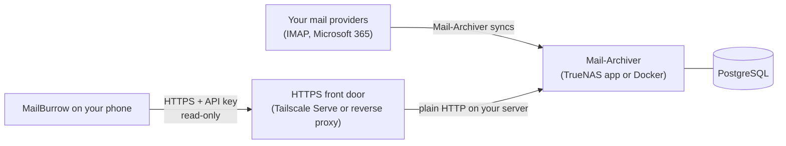

# Setting up MailBurrow with your own archive

[Main index](../README.md) · [Troubleshooting](troubleshooting/README.md) · [Privacy notice](../PRIVACY.md)

MailBurrow is a phone app for reading the mail you already archive with [Mail-Archiver](https://github.com/s1t5/mail-archiver) or [Open Archiver](https://github.com/LogicLabs-OU/OpenArchiver). It talks only to your own archive servers, over HTTPS, with API keys you create. This guide covers how the pieces fit together and the exact settings each one needs.

- **Mail-Archiver:** follow steps 1 to 4.
- **Open Archiver:** follow [Open Archiver steps 1 and 2](#open-archiver-step-1-create-a-read-only-role), then steps 3 and 4.
- **Both:** set up one, then add the other in the app. See [several archives](#several-archives).

The same guide is on the [MailBurrow website](https://mailburrow.pages.dev/setup.html).

To see what the app looks like before setting anything up, tap **Try the demo** on the setup screen: it opens fictional sample mail built into the app, with no server needed.

Checked against Mail-Archiver's [REST API guide](https://github.com/s1t5/mail-archiver/blob/main/doc/API.md), Open Archiver 0.6.2, the TrueNAS Mail Archiver, Open Archiver and Tailscale apps, and Tailscale's HTTPS and Serve documentation, as of November 2026. Menu names can change between versions.

## How it works



- **Your archive server does the archiving.** Mail-Archiver or Open Archiver copies mail from your providers into its own storage. MailBurrow never connects to Gmail, Outlook or any mail provider, and never sees your mailbox passwords. Open Archiver works the same way as the diagram, with its own database and search service.
- **MailBurrow only reads.** It uses the server's API to list accounts or sources, folders and messages, run searches, and download attachments you ask for. It can't change, delete or send mail.
- **Nothing is kept on the phone.** Messages are fetched when you open them and aren't stored for offline reading. Only the server address and API key are saved, in the phone's secure storage.
- **HTTPS is required.** The app checks the server's certificate and refuses plain `http://` addresses, so your key is never sent unencrypted.

## What you need

| Piece | Required? | What it does |
| --- | --- | --- |
| [Mail-Archiver](https://github.com/s1t5/mail-archiver), release **2607.3 or later**, or [Open Archiver](https://github.com/LogicLabs-OU/OpenArchiver) **0.6.2** | Yes, at least one | Archives your mail and provides the API. Mail-Archiver's API is **off by default**. Other Open Archiver versions haven't been tested. |
| An API key for that server | Yes | Lets the app read the archive with its user's permissions. |
| An HTTPS address with a **trusted certificate** | Yes | For example `https://archive.example.ts.net`. Self-signed certificates don't work. |
| [Tailscale](https://tailscale.com/) on the server and the phone | Recommended | Private access from anywhere, plus a free trusted certificate through Tailscale Serve. |
| TrueNAS | Optional | One easy way to run either server, through its community app. Docker on any machine works too. |
| Your own domain and a reverse proxy | Optional | An alternative to Tailscale for the HTTPS address. |

## Step 1: Turn on Mail-Archiver's API

The API is controlled by the `Api__Enabled` setting. While it's off, every `/api/` address returns "not found", and MailBurrow reports *Archive API or message unavailable*.

**TrueNAS app:**

1. Open **Apps**, select **Mail Archiver** and choose **Edit**.
2. Under **Additional Environment Variables**, add **Name** `Api__Enabled` with **Value** `true`.
3. Save. The app restarts.
4. Check the app version is 2607.3 or later; update the app if it isn't.

**Docker Compose:** add this to the Mail-Archiver service's `environment:` list, then recreate the container:

```yaml
      - Api__Enabled=true
```

Optional settings, from Mail-Archiver's [setup guide](https://github.com/s1t5/mail-archiver/blob/main/doc/Setup.md):

- `Api__AllowAttachmentDownloads` is `true` by default. Leave it on, or attachment downloads in the app will fail.
- `Api__RateLimitPerMinute` is `120` by default. That's plenty for one phone. If you see *Too many requests*, wait a minute.

## Step 2: Create an API key

A key **inherits the permissions of the user who creates it**. A regular user's key sees only the mail accounts assigned to that user; an administrator's key sees every account on the server. For a phone, use a regular user that has only the accounts you want to read on it.

1. Sign in to Mail-Archiver's web interface as that user.
2. Open the **API Keys** page and create a key. Give it a clear name such as "MailBurrow phone", and an expiry date if you like.
3. Copy the key straight away. It starts with `ma_` and is shown only once.

Keep the key private. Never paste it into chats, issue reports or screenshots. If your phone is lost, revoke the key on the same **API Keys** page; an administrator can revoke any user's keys.

## Open Archiver step 1: Create a read-only role

Open Archiver's API needs no setting to turn on. What matters is which user owns the key, because **a key has its user's permissions**. An administrator's key can see and change everything on the server, so give the phone its own user with a role that can only read the sources you want on it.

1. Sign in to Open Archiver as an administrator.
2. Open **Admin → Roles** and create a role, for example "MailBurrow read-only".
3. Find the ID of each source the phone should read: open **Archive → Ingestion**, select the source, and copy the value after `ingestionSourceId=` in the page's address.
4. Enter this policy, replacing `SOURCE_ID` with that ID. To allow several sources, list each ID inside both pairs of brackets.

   ```json
   [
     {
       "action": ["read", "search"],
       "subject": "ingestion",
       "conditions": { "id": { "$in": ["SOURCE_ID"] } }
     },
     {
       "action": ["read", "search"],
       "subject": "archive",
       "conditions": { "ingestionSourceId": { "$in": ["SOURCE_ID"] } }
     }
   ]
   ```

   The first rule lets the user see the source; the second lets them read and search its mail. Nothing in it allows changing, deleting or exporting.
5. Create a user for the phone and give it this role.

## Open Archiver step 2: Create an API key

1. Sign in to Open Archiver as the phone's user from step 1, not as an administrator.
2. Open **Settings → API Keys** and choose **Generate API Key**. Give it a clear name such as "MailBurrow phone" and choose an expiry.
3. Copy the key straight away. It's shown only once.

Keep the key private, as for Mail-Archiver. If your phone is lost, delete the key on the same page. When a key expires or is deleted, MailBurrow offers **Enter a new key** for that archive.

**What the app shows from Open Archiver:**

- **Sources appear as accounts.** Switch between them from the account row, as with Mail-Archiver accounts.
- **Search counts are estimates,** shown as "about N matches". Browsing a source shows exact counts.
- **There are no folders or server-wide totals.** Open Archiver's API has no folder browsing, and its totals are for administrators only. The reader shows each message's folder path instead.
- **Sources with Preserve Original File turned on are listed but their messages don't open.** Those sources keep each full original message, attachments included, so opening one would download every attachment without asking. Use Open Archiver's website for those sources, or keep the phone's role to sources without that option.
- **Searches can match text inside attachments.** The matching text arrives with the results and is discarded with them; it isn't saved on the phone. Attachments themselves download only when you save one.
- **Rate limit:** by default, Open Archiver allows about 100 requests a minute per key. If you see *Too many requests*, wait a minute.

## Step 3: Give the server an HTTPS address

Mail-Archiver and Open Archiver both serve plain HTTP. On TrueNAS, Mail-Archiver's default web port is `30315`; for Open Archiver, use the web port shown in its app settings. Put one of the following in front of each server.

### Option A: Tailscale Serve (recommended)

Tailscale Serve gives your server an address like `https://truenas.your-tailnet.ts.net` with a certificate phones trust, reachable only from devices signed in to your Tailscale network.

1. In the [Tailscale admin console](https://login.tailscale.com/admin/dns), open **DNS**, make sure **MagicDNS** is on, and under **HTTPS Certificates** select **Enable HTTPS**.
2. On the server, point Serve at Mail-Archiver's port:

   ```sh
   tailscale serve --bg 30315
   ```

   Replace `30315` with your port if it differs. The output shows your HTTPS address. `--bg` keeps it running in the background.
3. Check it: `tailscale serve status` should show `https://<machine>.<tailnet>.ts.net` forwarding to your port.

**Two servers on one machine:** each needs its own HTTPS port. Keep the first on the default port, and give the second one another port, such as `8443`:

```sh
tailscale serve --bg --https=8443 <second-server-port>
```

Its address then ends in `:8443`, for example `https://truenas.your-tailnet.ts.net:8443`. Enter it in the app with the port.

**On TrueNAS** with the Tailscale community app:

- Follow [Tailscale's TrueNAS guide](https://tailscale.com/kb/1483/truenas) to install the app with an auth key. Then edit the app: **untick Userspace** and **tick Host Network**, so Tailscale can reach the Mail Archiver app's port on the host.
- The app's form doesn't include a Serve setting, so run the `tailscale serve --bg 30315` command in a **shell inside the Tailscale app**, opened from the app's details on the **Apps** page. After the next restart, run `tailscale serve status` again to check the setting was kept.

The first connection can take a few seconds while Tailscale issues the certificate.

### Option B: Your own domain with a reverse proxy

If you already run a reverse proxy such as Caddy, Nginx Proxy Manager or Traefik with Let's Encrypt certificates, add a host like `mail.example.com` that forwards to Mail-Archiver's port. Some things to watch:

- The certificate must be publicly trusted. Let's Encrypt is fine; self-signed certificates and private certificate authorities aren't supported.
- **No redirects.** MailBurrow doesn't follow redirects, so its key is never sent anywhere unexpected. Use the final address, and don't put a login page or single sign-on in front of `/api/`.
- If Mail-Archiver lives under a path such as `https://example.com/mail`, enter that full address in the app; the path is kept.
- If the address is reachable from the internet, your archive's web interface is too. Consider keeping it private, for example with Tailscale or a VPN, and keep Mail-Archiver updated.

### Addresses that won't work

| Address | Why |
| --- | --- |
| `http://truenas:30315` or `http://100.x.y.z:30315` | Plain HTTP. The app only connects over HTTPS. |
| `https://192.168.1.10` with a self-signed certificate | The certificate isn't trusted. |
| An address that redirects to another one | The app doesn't follow redirects. Use the final address. |

## Step 4: Connect the app

1. If you use Tailscale, install the **Tailscale** app on your phone and sign in to the same Tailscale network. Turn it on.
2. Optional check: open your HTTPS address in the phone's browser. You should see your server's sign-in page with no certificate warning.
3. Open MailBurrow and choose the server type, **Mail-Archiver** or **Open Archiver**. The app never guesses it.
4. Enter:
   - **HTTPS server address:** for example `truenas.your-tailnet.ts.net`, with `:8443` or another port if you used one. `https://` is added if you leave it out. Don't add `/api`.
   - **API key:** the key from step 2.
5. Tap **Connect to archive**.

If the key can see more than one mail account or source, switch between them from the account row or in Settings. **Disconnect and forget connection** in Settings removes the open archive's address and key from the phone; it doesn't revoke the key on the server.

## Several archives

MailBurrow can keep up to 20 archives, for example a Mail-Archiver and an Open Archiver server, and switch between them without entering keys again.

- **Add one:** tap the archive name above the account on the Mail tab, then **Add archive**. Choose its type, then enter its address and key.
- **Switch:** tap the archive name and pick another. The previous archive's mail is cleared before the new one loads, and each archive remembers the account or source you last used in it. If one can't be reached, the app says which, and offers **Retry saved connection** and your other archives. **Cancel** stops waiting.
- **Manage:** **Settings → Archives** lets you rename an archive, change its address or key, or forget it on this device. Changing an address or key always asks for the key again; the saved key is never sent to a new address. To use another server type, add it as a new archive.

Only one archive is open at a time. There's no combined inbox or search across archives.

## If something goes wrong

| Message in the app | Likely cause | What to do |
| --- | --- | --- |
| Enter a valid HTTPS server address… | The address has `http://`, a username and password, a query or a fragment | Enter just the host name, or `https://` plus host name and optional path |
| Unable to connect. Check your HTTPS address and private network. | Tailscale is off on the phone, the address is wrong, or Serve or the proxy isn't running | Turn on Tailscale, open the address in the phone's browser, check `tailscale serve status` |
| The server certificate could not be verified. | Self-signed or untrusted certificate | Use Tailscale Serve or a Let's Encrypt certificate |
| Your API key was not accepted. | Key mistyped, expired or revoked, or its user is inactive | Create a new key and enter it again; for a saved archive, use **Enter a new key** |
| This source keeps full original messages… | The Open Archiver source has Preserve Original File turned on | Read it on Open Archiver's website; MailBurrow doesn't open those messages |
| Archive API or message unavailable. | Mail-Archiver's API isn't enabled or it's older than 2607.3, the wrong server type is chosen, the address points at the wrong service, or the message is outside the key's accounts or sources | Check the server type, `Api__Enabled=true` and the version, then the address |
| Too many requests. Wait and retry. | More than the rate limit (120 a minute by default for Mail-Archiver, about 100 for Open Archiver) | Wait a minute |
| The server took too long to respond. | Slow connection or busy server | Retry; check the server is running |

More detail is in [troubleshooting](troubleshooting/README.md). When asking for help, never include your API key, server address or messages.

## Privacy and security in short

- Treat the API key as read access to its user's archived mail. Use a regular user, not an administrator, with only the accounts or sources you need. For Open Archiver, use the read-only role from Open Archiver step 1.
- Your server keeps its own access logs. MailBurrow has no analytics or crash reporting. See the [privacy notice](../PRIVACY.md).
- MailBurrow downloads an attachment only when you choose to, and saves it where you pick.
- Report security problems privately, as described in [SECURITY.md](../SECURITY.md).
